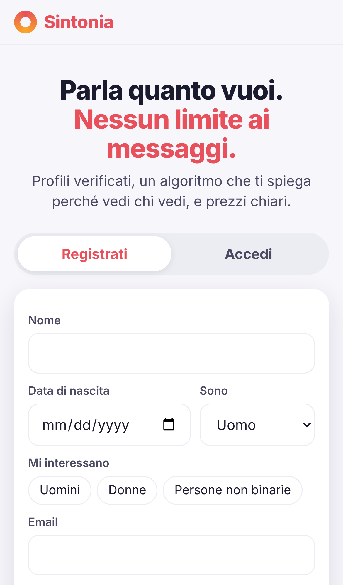
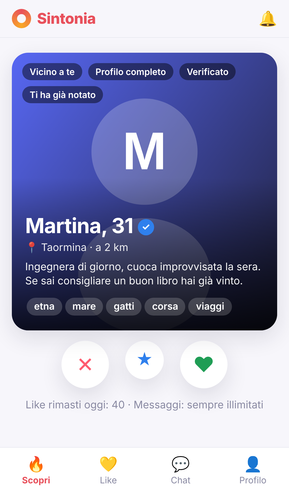
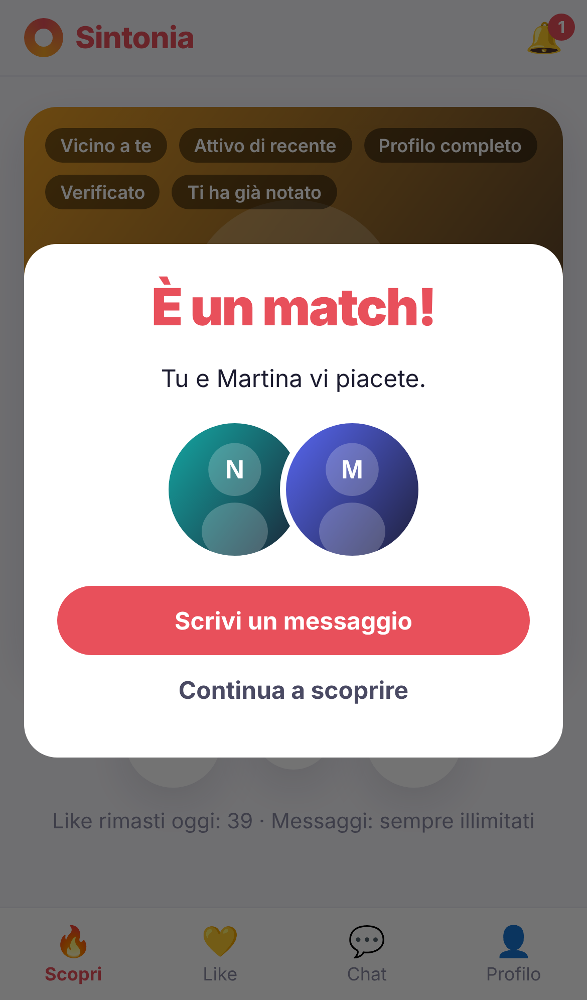
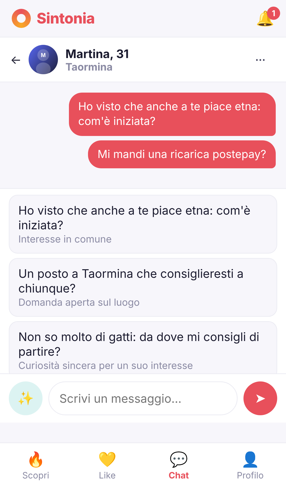
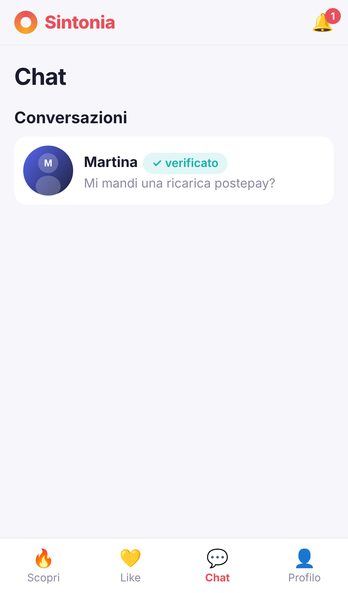
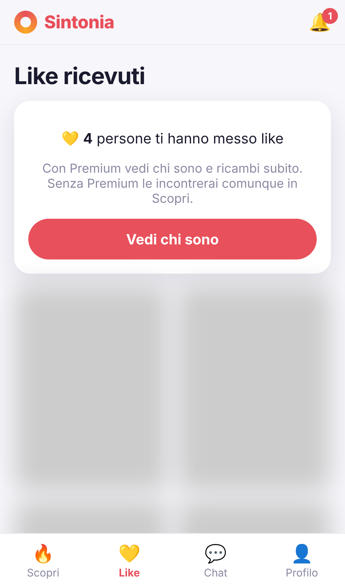
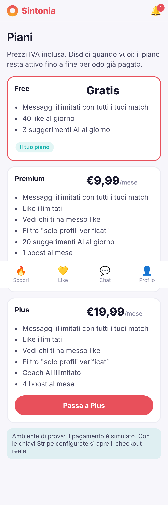
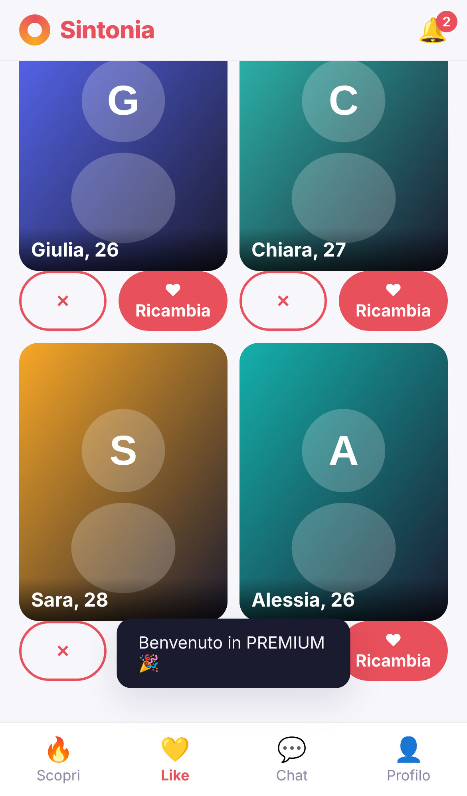
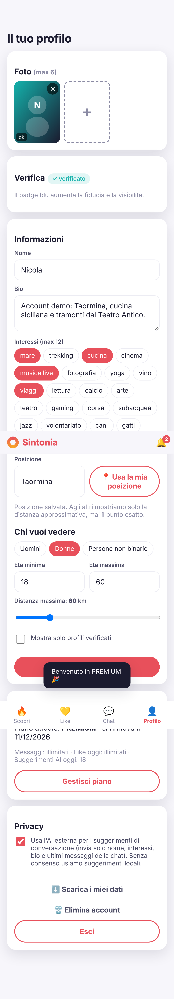
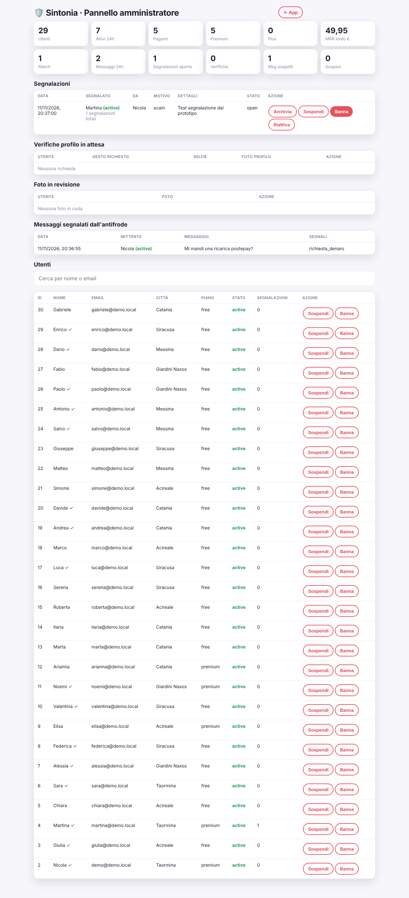

# 7. Schermate del prototipo (catturate dal prototipo reale)

Screenshot generati con Playwright (emulazione iPhone 13) facendo davvero il percorso: registrazione → Scopri → like → match → chat con suggerimenti → piani → upgrade → profilo → segnalazione → pannello admin. Nessun errore JavaScript durante il percorso.

| | |
|---|---|
|  **Registrazione**: consenso art. 9 separato, solo maggiorenni |  **Scopri**: carta con "perché vedi questo profilo", distanza approssimata, like rimasti, messaggi illimitati |
|  **Match** |  **Chat** in tempo reale con suggerimenti ✨ |
|  **Lista chat** |  **Like ricevuti** (Free: numero visibile, volti nascosti) |
|  **Piani**: prezzi chiari, disdetta con un clic |  **Like ricevuti** dopo l'upgrade |
|  **Profilo**: foto, verifica, filtri, privacy, esportazione/cancellazione dati |  **Admin**: KPI, segnalazioni, verifiche, antifrode, utenti |

Le "foto" dei profili demo sono avatar SVG generati: nessuna persona reale.
